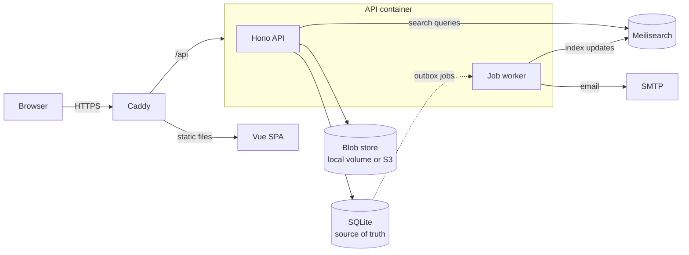

# myli

A self-hosted recipe manager for your household, run with Docker Compose.

> **Status: Phase 0 (foundation) in progress.** The app isn't usable yet.

## Features

- **Structured recipes:** ingredient groups, parsed quantities and units, ordered steps with markdown and photos, prep, cook and total times, difficulty, and nutrition entered by hand.
- **Scaling:** any serving size, shown as readable fractions, in metric or imperial.
- **Search:** typo-tolerant full-text search, ingredient autocomplete, filtering on several ingredients, and filters for cuisine, meal type, diet, allergens, difficulty and total time. Sort by rating, recency or time.
- **Collaboration:**
  - drafts and published versions
  - full revision history, with side-by-side comparison and restore
  - protection against overwriting someone else's edits
  - comments and ratings
- **Personal organization:** favorites, collections and private notes.
- **Shopping lists:** built from selected recipes, with quantities scaled, units normalized and duplicates merged.
- **Cook mode:** a large-type view of the whole recipe that keeps your screen awake.
- **Access control:** invite-only accounts with admin, editor and viewer roles. Recipes can be private, shared with everyone on the instance, or shared through a read-only public link. Admins get an audit log.
- **Your data:** recipe export as JSON or schema.org JSON-LD, full-instance export, and backups.

The full specification is in [`docs/spec.md`](docs/spec.md).

## Architecture



- **SQLite is the source of truth.** Every recipe change also queues a search update in the same transaction, and a background worker pushes it to Meilisearch. Search is eventually consistent and can always be rebuilt from SQLite.
- **One contract for the API.** Zod schemas generate the OpenAPI document, which drives both request validation and the typed frontend client.
- **Caddy provides HTTPS,** which browsers require before they'll keep the screen awake for cook mode on a phone.

### Stack

| Layer | Technology |
|---|---|
| Frontend | Vue 3, TypeScript, Vite, Vue Router, Pinia, TanStack Query, VeeValidate, shadcn-vue, Tailwind, Milkdown, Scalar (API docs) |
| API | Node, TypeScript, Hono, Zod, OpenAPI 3.1 |
| Data | SQLite, Drizzle ORM |
| Search | Meilisearch |
| Auth | Better Auth |
| Infrastructure | Docker Compose, Caddy, Garage (optional S3 storage), Mailpit (development) |
| Testing | Vitest, Testing Library, fast-check, Testcontainers, Playwright, axe |

### Design decisions

Each significant decision is recorded as an [Architecture Decision Record](docs/adr/):

1. [Hono with OpenAPI generated from Zod](docs/adr/0001-hono-with-openapi-from-zod.md)
2. [SQLite as the source of truth](docs/adr/0002-sqlite-as-source-of-truth.md)
3. [Meilisearch, synced through a transactional outbox](docs/adr/0003-meilisearch-with-transactional-outbox.md)
4. [Blob storage behind an interface, no MinIO](docs/adr/0004-blob-storage-abstraction-without-minio.md)
5. [Better Auth with instance-wide roles and custom invitations](docs/adr/0005-better-auth-instance-roles-and-invitations.md)
6. [Structured steps, with markdown edited in Milkdown](docs/adr/0006-structured-steps-and-milkdown.md)
7. [Revision snapshots and optimistic concurrency](docs/adr/0007-revision-snapshots-and-optimistic-concurrency.md)
8. [Run the API's TypeScript directly on Node, without a build step](docs/adr/0008-run-typescript-with-node-type-stripping.md)
9. [First-run setup takes a single-row claim instead of one transaction](docs/adr/0009-first-run-setup-claims-a-lock-row.md)
10. [Role changes and deactivation are written directly, in one transaction](docs/adr/0010-role-changes-and-deactivation-in-one-transaction.md)
11. [The API docs are a separate page of the web app](docs/adr/0011-api-docs-as-a-separate-page.md)

## Getting started

Setup instructions will be added once Phase 0 is done. The goal is a single `docker compose up` that starts a seeded demo instance with one account per role.

All configuration is done with environment variables. [`.env.example`](.env.example) lists every one with its default.

The first admin is created on the setup screen the first time you open myli. For an install where no one will open it, set `ADMIN_NAME`, `ADMIN_EMAIL` and `ADMIN_PASSWORD` instead: the admin is created at startup if no user exists yet. Remove `ADMIN_PASSWORD` once it has been.

## Development

You need Node 26.13.1 (pinned in `.node-version`) and pnpm 12.18.0 (pinned in `packageManager` in `package.json`; any other pnpm version switches to it automatically).

```sh
pnpm install     # also installs the git hooks (lefthook)
cp .env.example .env   # then set PUBLIC_URL, BETTER_AUTH_SECRET and MEILI_MASTER_KEY, as the comments explain
pnpm dev         # web app on http://localhost:5173, API on :3000 behind it; both reload on change
pnpm test        # Vitest, across every workspace package
pnpm test:e2e    # Playwright + axe, in Chromium and Firefox (first: pnpm --filter @myli/e2e exec playwright install chromium firefox)
pnpm test:containers   # the API against real Meilisearch, then Playwright against the Docker images (needs Docker)
pnpm typecheck   # tsc and vue-tsc, for every workspace package
pnpm lint        # ESLint; --fix also formats Vue templates
pnpm format      # Biome
pnpm openapi:generate   # refresh apps/api/openapi.json and the web app's API types after changing the API
pnpm db:generate        # create a migration after changing the database schema
```

The API docs are at http://localhost:5173/api/docs/ while `pnpm dev` runs.

In development, set `PUBLIC_URL=http://localhost:5173` in `.env`. The browser reaches the API through the web app's dev server, and sign-in only accepts requests from `PUBLIC_URL`. The API reads `.env` if it's there and shows readable logs.

The first time you open the web app, it asks you to create the first admin, then to sign in. Instead, you can set `ADMIN_NAME`, `ADMIN_EMAIL` and `ADMIN_PASSWORD` in `.env` before starting the API, which creates that admin on startup.

The pre-commit hook formats staged files, lints them, and typechecks the workspace.

Search needs [Meilisearch](https://www.meilisearch.com/), started with the master key from your `.env`. Without it, everything else works, and the API logs once that search is unavailable and keeps trying in the background.

```sh
docker run --rm -p 127.0.0.1:7700:7700 -e MEILI_NO_ANALYTICS=true \
  -e MEILI_MASTER_KEY="$(grep '^MEILI_MASTER_KEY=' .env | cut -d= -f2-)" \
  getmeili/meilisearch:v1.56.1
```

To see the emails myli sends while developing, run [Mailpit](https://mailpit.axllent.org/) and open its inbox at http://localhost:8025:

```sh
docker run --rm -p 1025:1025 -p 8025:8025 axllent/mailpit:v1.32.0
```

Then add this to your `.env`:

```sh
SMTP_HOST=localhost
SMTP_PORT=1025
SMTP_SECURITY=none
SMTP_FROM=myli <myli@example.com>
```

| Path | Contents |
|---|---|
| `apps/api` | Hono API |
| `apps/web` | Vue SPA |
| `packages/shared` | Zod schemas, types and logic used by both |

## Roadmap

| Phase | Scope |
|---|---|
| 0. Foundation | Monorepo, Compose stack, API skeleton with OpenAPI docs, database and migrations, authentication, roles, invitations, job worker, audit log, CI |
| 1. MVP | Recipes, ingredients, steps, tags, images, scaling, search, favorites, cook mode, print view |
| 2. Collaboration | Drafts and revisions, protection against overwritten edits, comments, ratings, collections, notes, public links, trash |
| 3. Shopping lists | Aggregation, unit normalization, merging duplicates, manual items |
| 4. Polish | URL import, exports, backup and restore tooling |

## License

This project is licensed under the PolyForm Noncommercial License 1.0.0.

You are free to use, modify, and distribute this software for noncommercial purposes, subject to the terms of the license.

Commercial use, including use for commercial advantage or monetary compensation, is not permitted without separate written permission from the copyright holder.

This software is provided "AS IS", without warranties or guarantees of any kind. The author assumes no liability for damages arising from the use or distribution of this software, to the extent permitted by applicable law.

See [LICENSE](./LICENSE) for the complete license terms.
