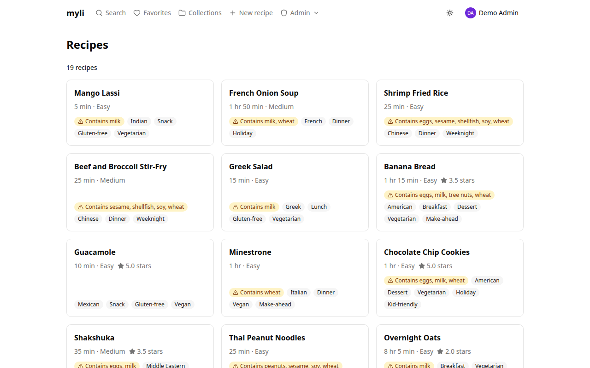
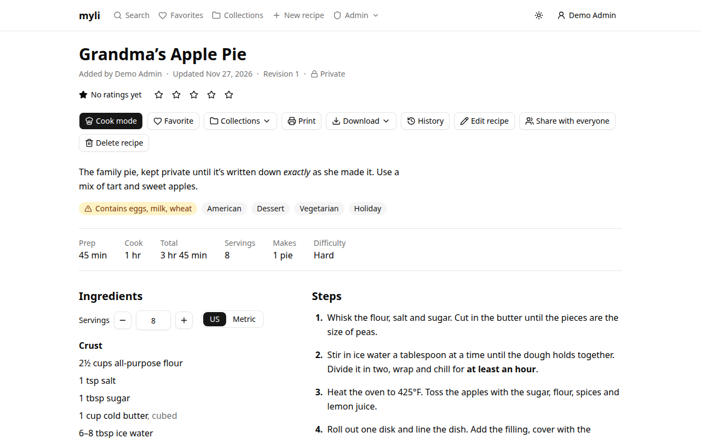
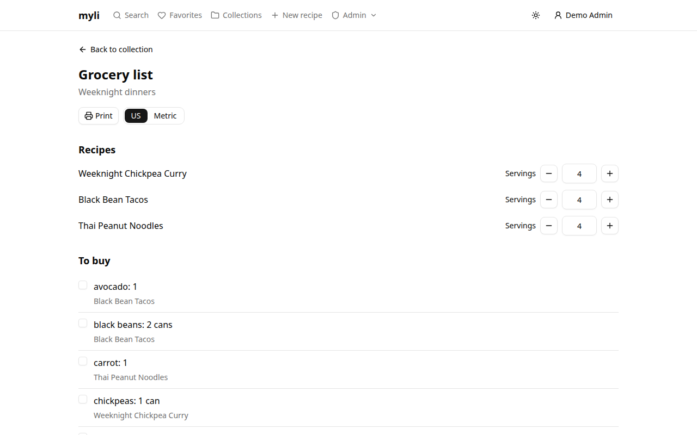
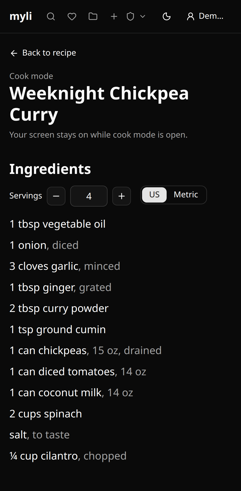
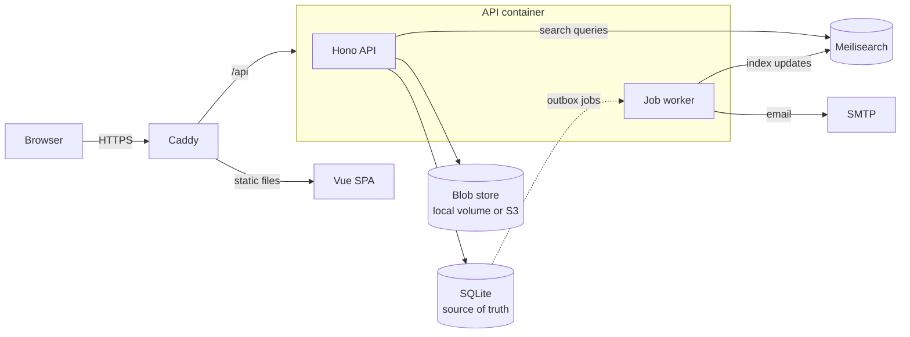

# myli

[](https://github.com/jdoiron94/myli/actions/workflows/ci.yml)

A self-hosted recipe manager for your household, run with Docker Compose.

> **Status: Phase 5 (accounts) under way: the Account page, email verification, and changing and resetting passwords done.** Recipes, search, scaling, favorites, collections and their grocery lists, notes, cook mode, revisions, the trash, comments, ratings, public links, importing from a link, exports, keeping photos in S3, and nightly backups with a restore command all work, and [Running myli](docs/operating.md) covers running it.

## Features

What myli does:

- **Structured recipes:** ingredient groups, parsed quantities and units, ordered steps with markdown and photos, prep, cook and total times, difficulty, and nutrition entered by hand.
- **Scaling:** any serving size, shown as readable fractions, in metric or imperial.
- **Import from a link:** a recipe site's page fills in a new recipe, photo included, to check before saving.
- **Export:** download a recipe as JSON, or as schema.org JSON-LD for other recipe apps. Admins download every recipe they can see, with its history and photos, as one archive.
- **Search:** typo-tolerant full-text search, ingredient autocomplete, filtering on several ingredients, and filters for cuisine, meal type, diet, allergens, difficulty and total time. Sort by rating, recency or time.
- **Collaboration:**
  - drafts and published versions
  - full revision history, with side-by-side comparison and restore
  - protection against overwriting someone else's edits
  - a trash, where deleted recipes can be restored for 30 days, or as long as you set
  - comments and ratings
- **Personal organization:** favorites, collections and private notes.
- **Grocery lists:** a collection's recipes added up into one list to tick off or print, with quantities scaled, units converted and duplicates merged.
- **Cook mode:** a large-type view of the whole recipe that keeps your screen awake.
- **Access control:** invite-only accounts with admin, editor and viewer roles. Recipes can be private, shared with everyone on the instance, or shared through a read-only public link. Admins get an audit log.
- **Accounts:** an Account page to verify your address and change your password. A forgotten password is reset with an emailed link, or, without email, one whoever runs the server makes.
- **Your data:** recipe export as JSON or schema.org JSON-LD, full-instance export, and nightly backups of the database and the photos on the server's disk, restored with one command. Photos are kept on the server's disk, or in any bucket that speaks S3, such as Garage, which Compose can run.

The full specification is in [`docs/spec.md`](docs/spec.md).

## Screenshots

<p>
  
  
</p>
<p>
  
  
</p>

The home page, a recipe, a collection's grocery list, and cook mode on a phone. `pnpm screenshots` takes them from the demo recipes.

## Quick start

myli runs with Docker Compose. You need Docker with Docker Compose, and an address for the server that the household's devices can reach, such as `myli.home.arpa` or the server's IP address.

```sh
git clone https://github.com/jdoiron94/myli.git && cd myli
cp .env.example .env    # then set PUBLIC_URL, BETTER_AUTH_SECRET and MEILI_MASTER_KEY, as it says
docker compose up --detach --build
```

Then open `PUBLIC_URL` to create the first admin, and [trust myli's certificate](docs/operating.md#trust-mylis-certificate-on-each-device) on each device.

- **[Running myli](docs/operating.md)** is the guide for whoever runs it: installing it, published releases, keeping photos in S3, backups and restores.
- **[Developing myli](docs/development.md)** covers working on its code: the tools, the commands, the tests, CI and releases.

## Architecture



- **SQLite is the source of truth.** Every recipe change also queues a search update in the same transaction, and a background worker pushes it to Meilisearch. Search is eventually consistent and can always be rebuilt from SQLite.
- **One contract for the API.** Zod schemas generate the OpenAPI document, which drives both request validation and the typed frontend client.
- **Caddy provides HTTPS,** which browsers require before they'll keep the screen awake for cook mode on a phone.

### Stack

| Layer | Technology |
|---|---|
| Frontend | Vue 3, TypeScript, Vite, Vue Router, TanStack Query, VeeValidate, shadcn-vue, Tailwind, Milkdown, Scalar (API docs) |
| API | Node, TypeScript, Hono, Zod, OpenAPI 3.1 |
| Data | SQLite, Drizzle ORM |
| Search | Meilisearch |
| Auth | Better Auth |
| Infrastructure | Docker Compose, Caddy, Mailpit (development), Garage (optional S3 storage) |
| Testing | Vitest, Testing Library, fast-check, Testcontainers, Playwright, axe |

### Design decisions

Each significant decision is recorded as an [Architecture Decision Record](docs/adr/):

1. [Hono with OpenAPI generated from Zod](docs/adr/0001-hono-with-openapi-from-zod.md)
2. [SQLite as the source of truth](docs/adr/0002-sqlite-as-source-of-truth.md)
3. [Meilisearch, synced through a transactional outbox](docs/adr/0003-meilisearch-with-transactional-outbox.md)
4. [Blob storage behind an interface, no MinIO](docs/adr/0004-blob-storage-abstraction-without-minio.md)
5. [Better Auth with instance-wide roles and custom invitations](docs/adr/0005-better-auth-instance-roles-and-invitations.md)
6. [Structured steps, with markdown edited in Milkdown](docs/adr/0006-structured-steps-and-milkdown.md)
7. [Revision snapshots and optimistic concurrency](docs/adr/0007-revision-snapshots-and-optimistic-concurrency.md)
8. [Run the API's TypeScript directly on Node, without a build step](docs/adr/0008-run-typescript-with-node-type-stripping.md)
9. [First-run setup takes a single-row claim instead of one transaction](docs/adr/0009-first-run-setup-claims-a-lock-row.md)
10. [Role changes and deactivation are written directly, in one transaction](docs/adr/0010-role-changes-and-deactivation-in-one-transaction.md)
11. [The API docs are a separate page of the web app](docs/adr/0011-api-docs-as-a-separate-page.md)
12. [A strict Content Security Policy, with inline styles allowed on the API docs page](docs/adr/0012-content-security-policy.md)
13. [HTTPS with Caddy's local certificate authority](docs/adr/0013-https-with-caddys-local-ca.md)
14. [Markdown is edited with Milkdown's kit, held to the subset, not with Crepe](docs/adr/0014-milkdown-kit-held-to-the-markdown-subset.md)
15. [The markdown editor reads markdown with the renderer's parser](docs/adr/0015-editor-reads-markdown-with-the-renderers-parser.md)
16. [A public link carries its token in the path](docs/adr/0016-public-link-token-in-the-path.md)
17. [The SSRF guard checks the address it connects to, on Node's own HTTP client](docs/adr/0017-ssrf-guard-checks-the-connected-address.md)
18. [Nightly backups in the worker: one zip of the database and the photos on disk](docs/adr/0018-nightly-backups-in-the-worker.md)
19. [Email verification and password reset with myli's own tokens, sent from jobs](docs/adr/0019-account-emails-with-myli-tokens-sent-from-jobs.md)

## Roadmap

| Phase | Scope | Status |
|---|---|---|
| 0. Foundation | Monorepo, Compose stack, API skeleton with OpenAPI docs, database and migrations, authentication, roles, invitations, job worker, audit log, CI | Done |
| 1. MVP | Recipes, ingredients, steps, tags, images, scaling, search, favorites, cook mode, print view | Done |
| 2. Collaboration | Drafts and revisions, protection against overwritten edits, comments, ratings, collections, notes, public links, trash | Done |
| 3. Grocery lists | A collection's ingredients added up, with servings per recipe, unit conversion and duplicates merged; check-off and printing | Done |
| 4. Polish | URL import, exports, S3 storage for photos, backup and restore tooling, an operator guide | Done |
| 5. Accounts | An Account page, email verification, changing and resetting passwords, profile photos | In progress: the Account page, verification, and changing and resetting passwords done |

## License

This project is licensed under the PolyForm Noncommercial License 1.0.0.

You are free to use, modify, and distribute this software for noncommercial purposes, subject to the terms of the license.

Commercial use, including use for commercial advantage or monetary compensation, is not permitted without separate written permission from the copyright holder.

This software is provided "AS IS", without warranties or guarantees of any kind. The author assumes no liability for damages arising from the use or distribution of this software, to the extent permitted by applicable law.

See [LICENSE](./LICENSE) for the complete license terms.

The favicon is “Steaming bowl” from [Fluent Emoji](https://github.com/microsoft/fluentui-emoji), copyright Microsoft Corporation, under the MIT License rather than this project’s. Its license text is in [`apps/web/public/favicon.svg`](./apps/web/public/favicon.svg).
