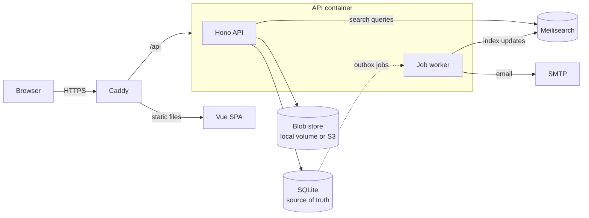

# myli

[](https://github.com/jdoiron94/myli/actions/workflows/ci.yml)

A self-hosted recipe manager for your household, run with Docker Compose.

> **Status: Phase 4 (polish) under way: import, exports and S3 storage done.** Recipes, search, scaling, favorites, collections and their grocery lists, notes, cook mode, revisions, the trash, comments, ratings, public links, importing from a link, exports and keeping photos in S3 work today. The [roadmap](#roadmap) shows what's done and what's next.

## Features

What myli does once the [roadmap](#roadmap) is done:

- **Structured recipes:** ingredient groups, parsed quantities and units, ordered steps with markdown and photos, prep, cook and total times, difficulty, and nutrition entered by hand.
- **Scaling:** any serving size, shown as readable fractions, in metric or imperial.
- **Import from a link:** a recipe site's page fills in a new recipe, photo included, to check before saving.
- **Export:** download a recipe as JSON, or as schema.org JSON-LD for other recipe apps. Admins download every recipe they can see, with its history and photos, as one archive.
- **Search:** typo-tolerant full-text search, ingredient autocomplete, filtering on several ingredients, and filters for cuisine, meal type, diet, allergens, difficulty and total time. Sort by rating, recency or time.
- **Collaboration:**
  - drafts and published versions
  - full revision history, with side-by-side comparison and restore
  - protection against overwriting someone else's edits
  - a trash, where deleted recipes can be restored for 30 days, or as long as you set
  - comments and ratings
- **Personal organization:** favorites, collections and private notes.
- **Grocery lists:** a collection's recipes added up into one list to tick off or print, with quantities scaled, units converted and duplicates merged.
- **Cook mode:** a large-type view of the whole recipe that keeps your screen awake.
- **Access control:** invite-only accounts with admin, editor and viewer roles. Recipes can be private, shared with everyone on the instance, or shared through a read-only public link. Admins get an audit log.
- **Your data:** recipe export as JSON or schema.org JSON-LD, full-instance export, and backups. Photos are kept on the server's disk, or in any bucket that speaks S3, such as Garage, which Compose can run.

The full specification is in [`docs/spec.md`](docs/spec.md).

## Architecture



- **SQLite is the source of truth.** Every recipe change also queues a search update in the same transaction, and a background worker pushes it to Meilisearch. Search is eventually consistent and can always be rebuilt from SQLite.
- **One contract for the API.** Zod schemas generate the OpenAPI document, which drives both request validation and the typed frontend client.
- **Caddy provides HTTPS,** which browsers require before they'll keep the screen awake for cook mode on a phone.

### Stack

| Layer | Technology |
|---|---|
| Frontend | Vue 3, TypeScript, Vite, Vue Router, TanStack Query, VeeValidate, shadcn-vue, Tailwind, Milkdown, Scalar (API docs) |
| API | Node, TypeScript, Hono, Zod, OpenAPI 3.1 |
| Data | SQLite, Drizzle ORM |
| Search | Meilisearch |
| Auth | Better Auth |
| Infrastructure | Docker Compose, Caddy, Mailpit (development), Garage (optional S3 storage, planned) |
| Testing | Vitest, Testing Library, fast-check, Testcontainers, Playwright, axe |

### Design decisions

Each significant decision is recorded as an [Architecture Decision Record](docs/adr/):

1. [Hono with OpenAPI generated from Zod](docs/adr/0001-hono-with-openapi-from-zod.md)
2. [SQLite as the source of truth](docs/adr/0002-sqlite-as-source-of-truth.md)
3. [Meilisearch, synced through a transactional outbox](docs/adr/0003-meilisearch-with-transactional-outbox.md)
4. [Blob storage behind an interface, no MinIO](docs/adr/0004-blob-storage-abstraction-without-minio.md)
5. [Better Auth with instance-wide roles and custom invitations](docs/adr/0005-better-auth-instance-roles-and-invitations.md)
6. [Structured steps, with markdown edited in Milkdown](docs/adr/0006-structured-steps-and-milkdown.md)
7. [Revision snapshots and optimistic concurrency](docs/adr/0007-revision-snapshots-and-optimistic-concurrency.md)
8. [Run the API's TypeScript directly on Node, without a build step](docs/adr/0008-run-typescript-with-node-type-stripping.md)
9. [First-run setup takes a single-row claim instead of one transaction](docs/adr/0009-first-run-setup-claims-a-lock-row.md)
10. [Role changes and deactivation are written directly, in one transaction](docs/adr/0010-role-changes-and-deactivation-in-one-transaction.md)
11. [The API docs are a separate page of the web app](docs/adr/0011-api-docs-as-a-separate-page.md)
12. [A strict Content Security Policy, with inline styles allowed on the API docs page](docs/adr/0012-content-security-policy.md)
13. [HTTPS with Caddy's local certificate authority](docs/adr/0013-https-with-caddys-local-ca.md)
14. [Markdown is edited with Milkdown's kit, held to the subset, not with Crepe](docs/adr/0014-milkdown-kit-held-to-the-markdown-subset.md)
15. [The markdown editor reads markdown with the renderer's parser](docs/adr/0015-editor-reads-markdown-with-the-renderers-parser.md)
16. [A public link carries its token in the path](docs/adr/0016-public-link-token-in-the-path.md)
17. [The SSRF guard checks the address it connects to, on Node's own HTTP client](docs/adr/0017-ssrf-guard-checks-the-connected-address.md)
18. [Nightly backups in the worker: one zip of the database and every photo](docs/adr/0018-nightly-backups-in-the-worker.md)

## Getting started

myli runs with Docker Compose: Caddy serves it over HTTPS and passes `/api` to the API, next to Meilisearch for search. You need Docker with Docker Compose (tested with Compose 5.7), and an address for the server that the household's devices can reach, such as a name like `myli.home.arpa` set up in your router's DNS, or the server's IP address.

### Run it

1. Clone this repository, and create `.env` from the example:

   ```sh
   cp .env.example .env
   ```

2. In `.env`, set at least:
   - `PUBLIC_URL`: `https://` and the server's address, like `https://myli.home.arpa`.
   - `BETTER_AUTH_SECRET` and `MEILI_MASTER_KEY`: generate each with `openssl rand -base64 32`.

   [`.env.example`](.env.example) explains every variable. Leave the `_FILE` variables empty: Compose hands the secrets to the containers as files itself. Keep `ADMIN_PASSWORD`, `SMTP_PASSWORD` and `S3_SECRET_ACCESS_KEY` listed, even empty, or Compose won't start.

3. Build the images and start the stack. It's ready when `docker compose ps` shows every service healthy.

   ```sh
   docker compose up --detach --build
   ```

4. Open `PUBLIC_URL` and create the first admin. For an install where no one will open the setup screen, set `ADMIN_NAME`, `ADMIN_EMAIL` and `ADMIN_PASSWORD` before starting instead: the admin is created at startup if no user exists yet. Empty `ADMIN_PASSWORD` once it has been.

   To try myli out instead, create demo accounts, one per role, and about twenty demo recipes, before anyone signs up. The script prints the accounts' passwords, once, and refuses on an instance that already has users:

   ```sh
   docker compose exec api node src/seed-demo.ts
   ```

Caddy takes ports 80 (which only redirects) and 443, on TCP and UDP. To use others, set `MYLI_HTTP_PORT` and `MYLI_HTTPS_PORT`, and put the HTTPS port in `PUBLIC_URL` too.

### Run a published release instead

Each release publishes both images to GitHub's container registry, privately: `ghcr.io/jdoiron94/myli-api` and `ghcr.io/jdoiron94/myli-web`, for linux/amd64. The [releases page](https://github.com/jdoiron94/myli/releases) lists each version and what changed.

1. Log Docker in to the registry once, with a GitHub personal access token (classic) that has only the `read:packages` scope:

   ```sh
   docker login ghcr.io --username <your GitHub username>
   ```

2. Set `MYLI_IMAGE_PREFIX=ghcr.io/jdoiron94/` and `MYLI_VERSION` to a release, like `0.1.0`, and start the stack without `--build`:

   ```sh
   docker compose up --detach
   ```

Then all you need is `compose.yaml` and the variables, which a Compose management tool can hold in place of `.env`, with the token as its credentials for `ghcr.io`.

To upgrade, back up first (`docker compose exec api node src/backup-now.ts`, below), set `MYLI_VERSION` to the new release, and run `docker compose up --detach` again. The API applies any database migrations as it starts.

### Trust myli's certificate on each device

Caddy has its own certificate authority, created in its `caddy-data` volume on first start ([ADR 0013](docs/adr/0013-https-with-caddys-local-ca.md)). Until a device trusts its root certificate, browsers warn about the connection, and cook mode can't keep the screen on. Each device trusts it once.

Copy the root certificate out, and note its fingerprint:

```sh
docker compose cp caddy:/data/caddy/pki/authorities/local/root.crt myli-root.crt
openssl x509 -in myli-root.crt -noout -fingerprint -sha256
```

Get `myli-root.crt` onto each device in a way you trust, such as AirDrop, a cable or a message to yourself. Where the device shows the fingerprint, check that it matches before trusting it.

- **iPhone and iPad:** open the file, then install the profile in Settings → General → VPN & Device Management. Then turn on full trust for "Caddy Local Authority" in Settings → General → About → Certificate Trust Settings.
- **Android:** Settings → Security → Encryption & credentials → Install a certificate → CA certificate. The menus vary by maker. Firefox for Android also needs its "Use third party CA certificates" setting.
- **macOS:** `sudo security add-trusted-cert -d -r trustRoot -k /Library/Keychains/System.keychain myli-root.crt`
- **Windows:** in a terminal run as administrator, `certutil -addstore -f Root myli-root.crt`
- **Linux:** on Debian and Ubuntu, `sudo cp myli-root.crt /usr/local/share/ca-certificates/ && sudo update-ca-certificates`. Firefox and Chrome on Linux keep their own lists: import the file in their certificate settings, as an authority that identifies websites.

A device that trusts this certificate trusts it for every site, not only myli. Whoever has the `caddy-data` volume could pretend to be any site to that device, so guard the volume like the server's other secrets.

### Public links

A recipe's public link holds its secret in its address, as `https://myli.home.arpa/p/<token>` ([ADR 0016](docs/adr/0016-public-link-token-in-the-path.md)). myli never logs it, nor sends it to other sites. If you put a proxy of your own in front of myli, keep it from logging paths under `/p/` and `/api/v1/public/`: anyone who reads those logs could open the recipes.

### Keep photos in S3

Photos are kept in the `api-data` volume unless you choose an S3 bucket instead: on AWS, or any store that speaks its API. Set, in `.env`:

```sh
BLOB_STORE=s3
S3_ENDPOINT=https://s3.example.com   # empty for AWS
S3_REGION=us-east-1                  # the region requests are signed for
S3_BUCKET=myli-photos
S3_ACCESS_KEY_ID=...
S3_SECRET_ACCESS_KEY=...
```

The bucket must exist, and its key must be allowed to read, write and delete objects in it. Nothing in it needs to be public: the API serves every photo itself, to whoever may see its recipe. myli puts the bucket's name in the path, as `https://s3.example.com/myli-photos/images/…`, not in the host name, so any store that speaks S3 can serve it.

#### With Garage, on the same machine

Compose's `s3` profile runs [Garage](https://garagehq.deuxfleurs.fr/), a store that speaks S3, next to the API, where only the API can reach it. Before the API starts, it sets Garage up: the bucket, and the API's key, allowed only to read, write and delete photos in it.

1. In `.env`, set:

   ```sh
   COMPOSE_PROFILES=s3                  # so every docker compose command includes Garage
   BLOB_STORE=s3
   S3_ENDPOINT=http://garage:3900
   S3_BUCKET=myli
   S3_ACCESS_KEY_ID=GK...               # echo "GK$(openssl rand -hex 12)"
   S3_SECRET_ACCESS_KEY=...             # openssl rand -hex 32
   MYLI_GARAGE_RPC_SECRET=...           # openssl rand -hex 32
   MYLI_GARAGE_ADMIN_TOKEN=...          # openssl rand -base64 32
   ```

2. Start the stack as usual. `docker compose ps --all` shows `garage-init` exited with code 0 once Garage is ready, and the API's log says `photos are kept in an S3 bucket`.

Garage keeps the photos in the `garage-data` volume. It can't change a key's secret: to change `S3_SECRET_ACCESS_KEY`, choose a new `S3_ACCESS_KEY_ID` too.

#### Switch with photos already uploaded

The photos uploaded so far stay where they were kept until they're copied into the new store:

1. Stop the API, so no photo is uploaded meanwhile:

   ```sh
   docker compose stop api
   ```

2. Change `BLOB_STORE` and the S3 variables in `.env`, as above.
3. Copy the photos into the new store from the old one. With Garage, this starts it and sets it up first. It says how many it copied, and can run again, leaving what it copied already:

   ```sh
   docker compose run --rm api node src/copy-photos.ts
   ```

4. Start the stack again: `docker compose up --detach`.

Nothing is deleted from the old store: once the photos show, free its space yourself. Going back to the `api-data` volume works the same way, with `BLOB_STORE=local`, and the S3 variables still set while the photos are copied from the bucket.

### Back up and restore

myli backs itself up every night at 03:30, server time, and when the API starts if its last backup is more than a day old. Each backup is one zip file: the database, copied as it was at one moment, and every photo it names, whether they're kept in the `api-data` volume or in an S3 bucket. The API's log says `backup saved` for each, with its size.

The newest 7 are kept in the `backups` volume. Set `BACKUP_KEEP` in `.env` to keep more or fewer, or to 0 to turn backups off. Each is a full copy, so seven take about seven times the space of the photos.

That volume is on the same disk as everything else. To keep backups on another, mount a directory from it at `/backups` instead, in a `compose.override.yaml` beside `compose.yaml`, and make it writable by uid 1000, the API's user (`sudo chown 1000:1000 /mnt/backups/myli`):

```yaml
services:
  api:
    volumes:
      - /mnt/backups/myli:/backups
```

Copy them off the machine too, with whatever you use for other files.

To back up now, before an upgrade for one, while the stack runs:

```sh
docker compose exec api node src/backup-now.ts
```

It says where it saved the backup, which counts among the 7 kept.

To restore one, stop the API, so nothing changes meanwhile, and give the backup's name. Without one, the command lists the backups, newest first:

```sh
docker compose stop api
docker compose run --rm api node src/restore-backup.ts myli-backup-2026-11-26T033000Z.zip
docker compose start api
```

It checks the backup before it changes anything, then puts its photos in the store `BLOB_STORE` names and its database in place. The database it replaces is kept beside it, renamed `myli.db.before-restore-<time>`, until you delete it. Photos uploaded since the backup stay in the store, unseen. The API rebuilds the search index as it starts. Everyone is signed out who signed in since the backup, and every change since is gone. Restore with the version of myli that made the backup, or a newer one: an older one doesn't know a newer database.

To move myli to another machine, set it up there as in [Getting started](#getting-started), with the same `.env`, and before you start it, restore a backup from the directory you copied it to:

```sh
docker compose run --rm -v "$PWD:/restore:ro" api node src/restore-backup.ts /restore/myli-backup-2026-11-26T033000Z.zip
```

Compose keeps the rest of myli's data in volumes, named after the project (`myli` unless you choose another):

| Volume | Contents |
|---|---|
| `myli_api-data` | The database and the photos, all of which the backups hold. With `BLOB_STORE=s3`, the photos are in the bucket instead, and the backups hold them too. |
| `myli_backups` | The backups. |
| `myli_caddy-data` | The certificate authority, which the backups don't hold. Without it, Caddy creates a new one, which every device has to trust again. Browsers that have seen myli won't let anyone click past the warning until then. |
| `myli_garage-data` | With Garage (the `s3` profile), the photos, which the backups hold. |
| `myli_meilisearch-data` | The search index, which is rebuilt from the database. No need to back it up: an empty index is rebuilt when the API starts. |

Caddy's certificate authority doesn't change once it's created, so archive its volume once:

```sh
docker run --rm -v myli_caddy-data:/data:ro -v "$PWD:/backup" alpine \
  tar -czf /backup/myli-caddy-data.tar.gz -C /data .
```

### Rebuild the search index

The search index is kept in step with the database as recipes change, and rebuilt by itself when it's found empty. Should search ever miss a recipe, rebuild it while the stack runs. Search keeps working meanwhile:

```sh
docker compose exec api node src/reindex-search.ts
```

## Development

You need Node at the version in `.node-version`, and pnpm at the version in `packageManager` in `package.json` (any other pnpm version switches to it automatically).

```sh
pnpm install     # also installs the git hooks (lefthook)
cp .env.example .env   # then set PUBLIC_URL, BETTER_AUTH_SECRET and MEILI_MASTER_KEY, as the comments explain
pnpm dev         # web app on http://localhost:5173, API on :3000 behind it; both reload on change
pnpm dev:all     # the same, with Meilisearch for search, started in Docker and stopped with them
pnpm test        # Vitest, across every workspace package
pnpm test:e2e    # Playwright + axe, in Chromium and Firefox (first: pnpm --filter @myli/e2e exec playwright install chromium firefox)
pnpm test:containers   # the API against real Meilisearch and its built image, then Playwright against the Compose stack (needs Docker)
pnpm typecheck   # tsc and vue-tsc, for every workspace package
pnpm lint        # ESLint; --fix also formats Vue templates
pnpm format      # Biome
pnpm openapi:generate   # refresh apps/api/openapi.json and the web app's API types after changing the API
pnpm db:generate        # create a migration after changing the database schema
pnpm seed               # demo accounts, one per role, and demo recipes, on a database with no users yet; prints the passwords
pnpm reindex            # rebuild the search index, through the API that pnpm dev runs
pnpm backup             # back up now, through the API that pnpm dev runs, into apps/api/data/backups
```

The API docs are at http://localhost:5173/api/docs/ while `pnpm dev` runs.

In development, set `PUBLIC_URL=http://localhost:5173` in `.env`. Docker Compose reads the same file, and Caddy needs an `https://` address, so to run the whole stack as well, keep its settings in another file and pass it with `docker compose --env-file`. The browser reaches the API through the web app's dev server, and sign-in only accepts requests from `PUBLIC_URL`. The API reads `.env` if it's there and shows readable logs.

The first time you open the web app, it asks you to create the first admin, then to sign in. Instead, you can set `ADMIN_NAME`, `ADMIN_EMAIL` and `ADMIN_PASSWORD` in `.env` before starting the API, which creates that admin on startup.

The pre-commit hook formats staged files, lints them, and typechecks the workspace. [CI](.github/workflows/ci.yml) runs every check above on each pull request to `main`, with `pnpm audit`, whose findings it reports without failing. [Renovate](renovate.json) opens dependency PRs on Mondays, only for releases at least a week old, and each waits for review. pnpm refuses to install anything younger, dependencies of dependencies included.

Commits follow [Conventional Commits](https://www.conventionalcommits.org/), which decide each release's version: `feat` bumps the minor version and `fix` the patch, and before 1.0 a breaking change bumps the minor too. On every push to `main`, [release-please](release-please-config.json) keeps a release PR open with the next version and its changelog. Merging it tags the release, creates the GitHub release, then [builds both images and publishes them](.github/workflows/release.yml). They aren't tested again: the pull requests merged since the last release ran the container tests on the same build.

Search needs [Meilisearch](https://www.meilisearch.com/), which `pnpm dev:all` starts with the master key from your `.env`: Compose's own Meilisearch, published on 127.0.0.1:7700 by `compose.dev.yaml`, in a project of its own (`myli-dev`), so a stack you run from `compose.yaml` keeps its own. It waits until Meilisearch is healthy before starting the dev servers, and stops it once you stop them, keeping its index for next time. With `pnpm dev` alone, everything else works, and the API logs once that search is unavailable and keeps trying in the background.

To see the emails myli sends while developing, start [Mailpit](https://mailpit.axllent.org/) from the Compose file's `dev` profile, and open its inbox at http://localhost:8025:

```sh
docker compose --profile dev up --detach mailpit
```

Then add this to your `.env`:

```sh
SMTP_HOST=localhost
SMTP_PORT=1025
SMTP_SECURITY=none
SMTP_FROM=myli <myli@example.com>
```

| Path | Contents |
|---|---|
| `apps/api` | Hono API |
| `apps/web` | Vue SPA |
| `packages/shared` | Zod schemas, types and logic used by both |
| `e2e` | Playwright end-to-end tests, against the dev servers or the Compose stack |

## Roadmap

| Phase | Scope | Status |
|---|---|---|
| 0. Foundation | Monorepo, Compose stack, API skeleton with OpenAPI docs, database and migrations, authentication, roles, invitations, job worker, audit log, CI | Done |
| 1. MVP | Recipes, ingredients, steps, tags, images, scaling, search, favorites, cook mode, print view | Done |
| 2. Collaboration | Drafts and revisions, protection against overwritten edits, comments, ratings, collections, notes, public links, trash | Done |
| 3. Grocery lists | A collection's ingredients added up, with servings per recipe, unit conversion and duplicates merged; check-off and printing | Done |
| 4. Polish | URL import, exports, S3 storage for photos, backup and restore tooling | In progress: import, exports and S3 storage done |

## License

This project is licensed under the PolyForm Noncommercial License 1.0.0.

You are free to use, modify, and distribute this software for noncommercial purposes, subject to the terms of the license.

Commercial use, including use for commercial advantage or monetary compensation, is not permitted without separate written permission from the copyright holder.

This software is provided "AS IS", without warranties or guarantees of any kind. The author assumes no liability for damages arising from the use or distribution of this software, to the extent permitted by applicable law.

See [LICENSE](./LICENSE) for the complete license terms.

The favicon is “Steaming bowl” from [Fluent Emoji](https://github.com/microsoft/fluentui-emoji), copyright Microsoft Corporation, under the MIT License rather than this project’s. Its license text is in [`apps/web/public/favicon.svg`](./apps/web/public/favicon.svg).
