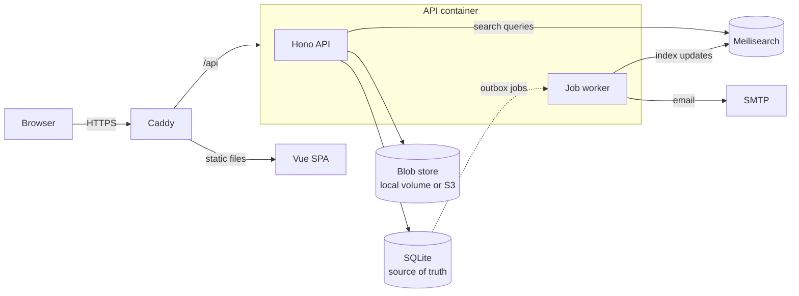

# myli

[](https://github.com/jdoiron94/myli/actions/workflows/ci.yml)

A self-hosted recipe manager for your household, run with Docker Compose.

> **Status: Phase 0 (foundation) in progress.** The app isn't usable yet.

## Features

- **Structured recipes:** ingredient groups, parsed quantities and units, ordered steps with markdown and photos, prep, cook and total times, difficulty, and nutrition entered by hand.
- **Scaling:** any serving size, shown as readable fractions, in metric or imperial.
- **Search:** typo-tolerant full-text search, ingredient autocomplete, filtering on several ingredients, and filters for cuisine, meal type, diet, allergens, difficulty and total time. Sort by rating, recency or time.
- **Collaboration:**
  - drafts and published versions
  - full revision history, with side-by-side comparison and restore
  - protection against overwriting someone else's edits
  - comments and ratings
- **Personal organization:** favorites, collections and private notes.
- **Shopping lists:** built from selected recipes, with quantities scaled, units normalized and duplicates merged.
- **Cook mode:** a large-type view of the whole recipe that keeps your screen awake.
- **Access control:** invite-only accounts with admin, editor and viewer roles. Recipes can be private, shared with everyone on the instance, or shared through a read-only public link. Admins get an audit log.
- **Your data:** recipe export as JSON or schema.org JSON-LD, full-instance export, and backups.

The full specification is in [`docs/spec.md`](docs/spec.md).

## Architecture



- **SQLite is the source of truth.** Every recipe change also queues a search update in the same transaction, and a background worker pushes it to Meilisearch. Search is eventually consistent and can always be rebuilt from SQLite.
- **One contract for the API.** Zod schemas generate the OpenAPI document, which drives both request validation and the typed frontend client.
- **Caddy provides HTTPS,** which browsers require before they'll keep the screen awake for cook mode on a phone.

### Stack

| Layer | Technology |
|---|---|
| Frontend | Vue 3, TypeScript, Vite, Vue Router, Pinia, TanStack Query, VeeValidate, shadcn-vue, Tailwind, Milkdown, Scalar (API docs) |
| API | Node, TypeScript, Hono, Zod, OpenAPI 3.1 |
| Data | SQLite, Drizzle ORM |
| Search | Meilisearch |
| Auth | Better Auth |
| Infrastructure | Docker Compose, Caddy, Garage (optional S3 storage), Mailpit (development) |
| Testing | Vitest, Testing Library, fast-check, Testcontainers, Playwright, axe |

### Design decisions

Each significant decision is recorded as an [Architecture Decision Record](docs/adr/):

1. [Hono with OpenAPI generated from Zod](docs/adr/0001-hono-with-openapi-from-zod.md)
2. [SQLite as the source of truth](docs/adr/0002-sqlite-as-source-of-truth.md)
3. [Meilisearch, synced through a transactional outbox](docs/adr/0003-meilisearch-with-transactional-outbox.md)
4. [Blob storage behind an interface, no MinIO](docs/adr/0004-blob-storage-abstraction-without-minio.md)
5. [Better Auth with instance-wide roles and custom invitations](docs/adr/0005-better-auth-instance-roles-and-invitations.md)
6. [Structured steps, with markdown edited in Milkdown](docs/adr/0006-structured-steps-and-milkdown.md)
7. [Revision snapshots and optimistic concurrency](docs/adr/0007-revision-snapshots-and-optimistic-concurrency.md)
8. [Run the API's TypeScript directly on Node, without a build step](docs/adr/0008-run-typescript-with-node-type-stripping.md)
9. [First-run setup takes a single-row claim instead of one transaction](docs/adr/0009-first-run-setup-claims-a-lock-row.md)
10. [Role changes and deactivation are written directly, in one transaction](docs/adr/0010-role-changes-and-deactivation-in-one-transaction.md)
11. [The API docs are a separate page of the web app](docs/adr/0011-api-docs-as-a-separate-page.md)
12. [A strict Content Security Policy, with inline styles allowed on the API docs page](docs/adr/0012-content-security-policy.md)
13. [HTTPS with Caddy's local certificate authority](docs/adr/0013-https-with-caddys-local-ca.md)

## Getting started

myli runs with Docker Compose: Caddy serves it over HTTPS and passes `/api` to the API, next to Meilisearch for search. You need Docker with Docker Compose (tested with Compose 5.7), and an address for the server that the household's devices can reach, such as a name like `myli.home.arpa` set up in your router's DNS, or the server's IP address.

### Run it

1. Clone this repository, and create `.env` from the example:

   ```sh
   cp .env.example .env
   ```

2. In `.env`, set at least:
   - `PUBLIC_URL`: `https://` and the server's address, like `https://myli.home.arpa`.
   - `BETTER_AUTH_SECRET` and `MEILI_MASTER_KEY`: generate each with `openssl rand -base64 32`.

   [`.env.example`](.env.example) explains every variable. Leave the `_FILE` variables empty: Compose hands the secrets to the containers as files itself. Keep `ADMIN_PASSWORD` and `SMTP_PASSWORD` listed, even empty, or Compose won't start.

3. Build the images and start the stack. It's ready when `docker compose ps` shows every service healthy.

   ```sh
   docker compose up --detach --build
   ```

4. Open `PUBLIC_URL` and create the first admin. For an install where no one will open the setup screen, set `ADMIN_NAME`, `ADMIN_EMAIL` and `ADMIN_PASSWORD` before starting instead: the admin is created at startup if no user exists yet. Empty `ADMIN_PASSWORD` once it has been.

   To try myli out instead, create demo accounts, one per role, before anyone signs up. The script prints their passwords, once, and refuses on an instance that already has users:

   ```sh
   docker compose exec api node src/seed-demo.ts
   ```

Caddy takes ports 80 (which only redirects) and 443, on TCP and UDP. To use others, set `MYLI_HTTP_PORT` and `MYLI_HTTPS_PORT`, and put the HTTPS port in `PUBLIC_URL` too.

### Run a published release instead

Each release publishes both images to GitHub's container registry, privately: `ghcr.io/jdoiron94/myli-api` and `ghcr.io/jdoiron94/myli-web`, for linux/amd64. The [releases page](https://github.com/jdoiron94/myli/releases) lists each version and what changed.

1. Log Docker in to the registry once, with a GitHub personal access token (classic) that has only the `read:packages` scope:

   ```sh
   docker login ghcr.io --username <your GitHub username>
   ```

2. Set `MYLI_IMAGE_PREFIX=ghcr.io/jdoiron94/` and `MYLI_VERSION` to a release, like `0.1.0`, and start the stack without `--build`:

   ```sh
   docker compose up --detach
   ```

Then all you need is `compose.yaml` and the variables, which a Compose management tool can hold in place of `.env`, with the token as its credentials for `ghcr.io`.

To upgrade, back up first (below), set `MYLI_VERSION` to the new release, and run `docker compose up --detach` again. The API applies any database migrations as it starts.

### Trust myli's certificate on each device

Caddy has its own certificate authority, created in its `caddy-data` volume on first start ([ADR 0013](docs/adr/0013-https-with-caddys-local-ca.md)). Until a device trusts its root certificate, browsers warn about the connection, and cook mode can't keep the screen on. Each device trusts it once.

Copy the root certificate out, and note its fingerprint:

```sh
docker compose cp caddy:/data/caddy/pki/authorities/local/root.crt myli-root.crt
openssl x509 -in myli-root.crt -noout -fingerprint -sha256
```

Get `myli-root.crt` onto each device in a way you trust, such as AirDrop, a cable or a message to yourself. Where the device shows the fingerprint, check that it matches before trusting it.

- **iPhone and iPad:** open the file, then install the profile in Settings → General → VPN & Device Management. Then turn on full trust for "Caddy Local Authority" in Settings → General → About → Certificate Trust Settings.
- **Android:** Settings → Security → Encryption & credentials → Install a certificate → CA certificate. The menus vary by maker. Firefox for Android also needs its "Use third party CA certificates" setting.
- **macOS:** `sudo security add-trusted-cert -d -r trustRoot -k /Library/Keychains/System.keychain myli-root.crt`
- **Windows:** in a terminal run as administrator, `certutil -addstore -f Root myli-root.crt`
- **Linux:** on Debian and Ubuntu, `sudo cp myli-root.crt /usr/local/share/ca-certificates/ && sudo update-ca-certificates`. Firefox and Chrome on Linux keep their own lists: import the file in their certificate settings, as an authority that identifies websites.

A device that trusts this certificate trusts it for every site, not only myli. Whoever has the `caddy-data` volume could pretend to be any site to that device, so guard the volume like the server's other secrets.

### Back up

Compose keeps myli's data in volumes, named after the project (`myli` unless you choose another):

| Volume | Contents |
|---|---|
| `myli_api-data` | The database: all of myli's data. |
| `myli_caddy-data` | The certificate authority. Without it, Caddy creates a new one, which every device has to trust again. Browsers that have seen myli won't let anyone click past the warning until then. |
| `myli_meilisearch-data` | The search index, which is rebuilt from the database. No need to back it up: an empty index is rebuilt when the API starts. |

Until myli has backups of its own, stop the stack and archive the first two:

```sh
docker compose stop
for volume in api-data caddy-data; do
  docker run --rm -v "myli_$volume:/data:ro" -v "$PWD:/backup" alpine \
    tar -czf "/backup/myli-$volume.tar.gz" -C /data .
done
docker compose start
```

### Rebuild the search index

The search index is kept in step with the database as recipes change, and rebuilt by itself when it's found empty. Should search ever miss a recipe, rebuild it while the stack runs. Search keeps working meanwhile:

```sh
docker compose exec api node src/reindex-search.ts
```

## Development

You need Node at the version in `.node-version`, and pnpm at the version in `packageManager` in `package.json` (any other pnpm version switches to it automatically).

```sh
pnpm install     # also installs the git hooks (lefthook)
cp .env.example .env   # then set PUBLIC_URL, BETTER_AUTH_SECRET and MEILI_MASTER_KEY, as the comments explain
pnpm dev         # web app on http://localhost:5173, API on :3000 behind it; both reload on change
pnpm test        # Vitest, across every workspace package
pnpm test:e2e    # Playwright + axe, in Chromium and Firefox (first: pnpm --filter @myli/e2e exec playwright install chromium firefox)
pnpm test:containers   # the API against real Meilisearch, then Playwright against the Compose stack (needs Docker)
pnpm typecheck   # tsc and vue-tsc, for every workspace package
pnpm lint        # ESLint; --fix also formats Vue templates
pnpm format      # Biome
pnpm openapi:generate   # refresh apps/api/openapi.json and the web app's API types after changing the API
pnpm db:generate        # create a migration after changing the database schema
pnpm seed               # demo accounts, one per role, on a database with no users yet; prints their passwords
pnpm reindex            # rebuild the search index, through the API that pnpm dev runs
```

The API docs are at http://localhost:5173/api/docs/ while `pnpm dev` runs.

In development, set `PUBLIC_URL=http://localhost:5173` in `.env`. Docker Compose reads the same file, and Caddy needs an `https://` address, so to run the whole stack as well, keep its settings in another file and pass it with `docker compose --env-file`. The browser reaches the API through the web app's dev server, and sign-in only accepts requests from `PUBLIC_URL`. The API reads `.env` if it's there and shows readable logs.

The first time you open the web app, it asks you to create the first admin, then to sign in. Instead, you can set `ADMIN_NAME`, `ADMIN_EMAIL` and `ADMIN_PASSWORD` in `.env` before starting the API, which creates that admin on startup.

The pre-commit hook formats staged files, lints them, and typechecks the workspace. [CI](.github/workflows/ci.yml) runs every check above on each push to a branch, with `pnpm audit`, whose findings it reports without failing. [Renovate](renovate.json) opens dependency PRs on Mondays, only for releases at least a week old, and each waits for review. pnpm refuses to install anything younger, dependencies of dependencies included.

Commits follow [Conventional Commits](https://www.conventionalcommits.org/), which decide each release's version: `feat` bumps the minor version and `fix` the patch, and before 1.0 a breaking change bumps the minor too. On every push to `main`, [release-please](release-please-config.json) keeps a release PR open with the next version and its changelog. Merging it tags the release, creates the GitHub release, then [tests both images and publishes them](.github/workflows/release.yml).

Search needs [Meilisearch](https://www.meilisearch.com/), started with the master key from your `.env`. Without it, everything else works, and the API logs once that search is unavailable and keeps trying in the background.

```sh
docker run --rm -p 127.0.0.1:7700:7700 -e MEILI_NO_ANALYTICS=true \
  -e MEILI_MASTER_KEY="$(grep '^MEILI_MASTER_KEY=' .env | cut -d= -f2-)" \
  getmeili/meilisearch:v1.56.1
```

To see the emails myli sends while developing, start [Mailpit](https://mailpit.axllent.org/) from the Compose file's `dev` profile, and open its inbox at http://localhost:8025:

```sh
docker compose --profile dev up --detach mailpit
```

Then add this to your `.env`:

```sh
SMTP_HOST=localhost
SMTP_PORT=1025
SMTP_SECURITY=none
SMTP_FROM=myli <myli@example.com>
```

| Path | Contents |
|---|---|
| `apps/api` | Hono API |
| `apps/web` | Vue SPA |
| `packages/shared` | Zod schemas, types and logic used by both |

## Roadmap

| Phase | Scope |
|---|---|
| 0. Foundation | Monorepo, Compose stack, API skeleton with OpenAPI docs, database and migrations, authentication, roles, invitations, job worker, audit log, CI |
| 1. MVP | Recipes, ingredients, steps, tags, images, scaling, search, favorites, cook mode, print view |
| 2. Collaboration | Drafts and revisions, protection against overwritten edits, comments, ratings, collections, notes, public links, trash |
| 3. Shopping lists | Aggregation, unit normalization, merging duplicates, manual items |
| 4. Polish | URL import, exports, backup and restore tooling |

## License

This project is licensed under the PolyForm Noncommercial License 1.0.0.

You are free to use, modify, and distribute this software for noncommercial purposes, subject to the terms of the license.

Commercial use, including use for commercial advantage or monetary compensation, is not permitted without separate written permission from the copyright holder.

This software is provided "AS IS", without warranties or guarantees of any kind. The author assumes no liability for damages arising from the use or distribution of this software, to the extent permitted by applicable law.

See [LICENSE](./LICENSE) for the complete license terms.
